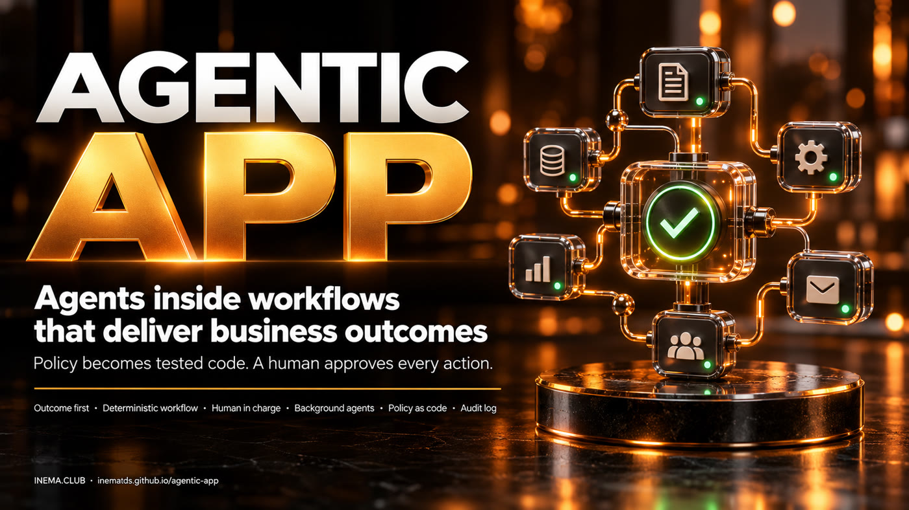

# agentic-app

**🇧🇷 [Português](README.md) · 🇺🇸 [English](README.en.md) · 🇪🇸 [Español](README.es.md)**

[](https://inematds.github.io/agentic-app/guia/en/)

## What it is

agentic-app is a Python framework for companies to build AI apps starting from a business outcome, not from the agent. It is for anyone who needs to put AI inside a real process (HR, people management, support) with control: the LLM runs inside a fixed workflow, every external action waits for human approval, rules with numbers become tested code and every run is recorded. It ships with a complete example app (manager coaching) and runs with just Python 3 installed, no key and no internet.

## 📖 Usage guide

Full guide (landing + step by step): **https://inematds.github.io/agentic-app/guia/en/**

## In 2 minutes

```bash
git clone https://github.com/inematds/agentic-app
cd agentic-app
bash tests/run.sh                 # 62 checks, no network -> last line OK
python3 -m agentic_app.demo       # runs the 5 workflows, generates saida/relatorio.html and saida/executivo.html
python3 -m agentic_app.serve      # panel at http://127.0.0.1:8765 (executive: /executivo?usuario=dora)
```

Nothing to install beyond Python 3.10+. The default LLM is `FakeLLM` (deterministic). To use a local model:
`AGENTIC_LLM=ollama python3 -m agentic_app.demo` (Ollama at `localhost:11434`).

## The 9 pillars (and where each one lives in the code)

| # | Pillar | Where |
|---|---|---|
| 1 | **Business outcome first** — who uses it, which decision, which metric | `templates/canvas-resultado.md`, `resultado_de_negocio` field of each workflow |
| 2 | **LLM inside a deterministic workflow** — 5 node types: context → code → condition → LLM → formatting; model chosen by the task | `agentic_app/workflow.py`, `agentic_app/config.py` |
| 3 | **UI component calls a workflow** — the result comes back to the same screen (editable draft) | `agentic_app/painel.html`, `agentic_app/serve.py` |
| 4 | **Human in command** — the workflow only PROPOSES; sending requires review, editing and approval | `agentic_app/acoes.py` |
| 5 | **Background agents** — they watch the data and suggest next steps with a run button | workflow `proximos_passos` |
| 6 | **Policy becomes tested code, not RAG** — the document becomes functions with strict input; RAG only for open-ended questions | `agentic_app/policies/ferias.py`, `tests/test_politica_ferias.py` |
| 7 | **Security per workflow** — who runs it (roles), which identity it acts as, chained audit log | `agentic_app/seguranca.py` |
| 8 | **Triggers beyond the click** — manual, scheduled, event | `agentic_app/gatilhos.py` |
| 9 | **Visual output** — HTML + PDF report instead of a wall of text | `agentic_app/relatorio.py` |

## The reference app: Manager coaching

Ana is a manager of 12 people (fictional data). The panel has five components, each tied to a workflow:

| Component | Workflow | What it does |
|---|---|---|
| Engagement panel | (direct read) | goals, engagement and days since the last 1:1, no LLM |
| Goal follow-up | `followup_metas` | email draft for those who missed their goal; Ana edits and approves |
| Next steps | `proximos_passos` | background agent (Monday 08:00) suggests who to talk to; running it produces a draft for review |
| HR assistant | `assistente_rh` | classifies the question, loads only the right policy, gives the agent only that policy's tools |
| Report | `relatorio_equipe` | team HTML + PDF |

A fifth workflow, `convite_1a1`, is called by the background agent's suggestions.

## Executive dashboard (1.1.0)

The view of whoever sponsors the app: **is it delivering the canvas business result, safely, and at what cost?**
Workflow `painel_executivo` (only the `diretoria` and `admin` roles; employee and manager are denied and audited),
route `/executivo`, `saida/executivo.html` + `.pdf`. Everything is computed from `audit.jsonl`, the approval queue,
the outbox and the app data by `agentic_app/executivo.py`, with schema-validated output:

| Block | What it shows (demo numbers) |
|---|---|
| Business result | canvas metric: 42.9% of overdue goals discussed within 7 days (target 90%, baseline 30%); goals completed 31.2%; average engagement 76.7; 6 people at risk |
| Agent operations | 9 runs (click 7, schedule 1, event 1); drafts: 1 approved with edits, 1 rejected, 6 pending; 1 of 10 suggestions accepted |
| Control and risk | access denied per role, tools blocked by least scope, hash chain intact or broken, 100% of external actions approved |
| LLM cost | 27 calls per model and per workflow, estimated tokens, cost from the `templates/indicadores.json` table (default 0) |
| Alerts | 3 to 5 sentences built by rules, not by an LLM |


## Repository map

| Path | What it is |
|---|---|
| `agentic_app/workflow.py` | engine: loads the JSON spec, runs the nodes, validates, audits |
| `agentic_app/llm.py` | `FakeLLM` (default) and `OllamaLLM` (optional, local) |
| `agentic_app/esquema.py` | output JSON validator (JSON Schema subset) |
| `agentic_app/acoes.py` | approval queue and simulated outbox |
| `agentic_app/seguranca.py` | users, roles, scoped identities, hashed audit log |
| `agentic_app/gatilhos.py` | manual, scheduled, event |
| `agentic_app/policies/` | encoded policies (fictional HR manual) |
| `agentic_app/apps/coaching/` | reference app: data, JSON workflows, functions |
| `agentic_app/executivo.py` | executive dashboard: result, operations, control and cost indicators + rule-based alerts |
| `templates/` | canvas, workflow template, policy template + test, permissions matrix, executive dashboard indicators |
| `docs/PASSO-A-PASSO.md` | from zero to rollout in a company (11 steps + checklist) — in Portuguese |
| `docs/ARQUITETURA.md` | how the pieces fit together — in Portuguese |
| `tests/` | `run.sh` (62 checks, no network) and `prova_mutacao.sh` |

## Where it fits

agentic-app is the **app + business workflows** layer. It does not replace the other two INEMA kits, it builds on them:

- **[agentic-starter](https://github.com/inematds/agentic-starter)** ([guide](https://inematds.github.io/agentic-starter/guia/)) — the company's agent in files: identity, skills, rules and measurement. It answers "**who** the agent is and how it works here".
- **[inema-agent-runtime](https://github.com/inematds/inema-agent-runtime)** ([guide](https://inematds.github.io/inema-agent-runtime/guia/)) — how agents discover, connect to and use the tools you already have. It answers "**how** the agent reaches the tools".
- **agentic-app** (this one) — the application the business person uses: screen, fixed workflow, policy as code, approval and audit. It answers "**what outcome** the company gets and how it runs every day".

## License

MIT. The data, people and HR manual in the example are fictional.

INEMA.CLUB · https://inema.club
