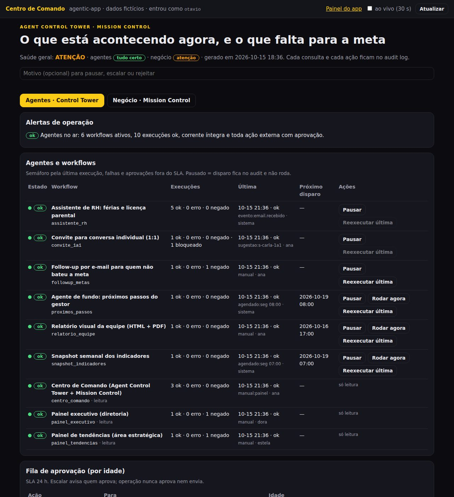
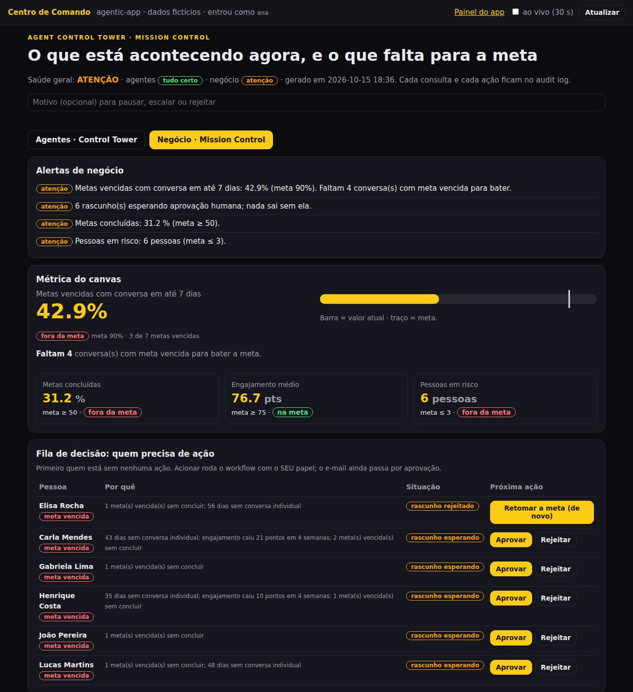

# agentic-app

**🇧🇷 [Português](README.md) · 🇺🇸 [English](README.en.md) · 🇪🇸 [Español](README.es.md)**

[](https://inematds.github.io/agentic-app/guia/es/)

## Qué es

agentic-app es un framework en Python para que las empresas construyan apps de IA a partir de un resultado de negocio, y no a partir del agente. Sirve para quien necesita poner IA dentro de un proceso real (RR. HH., gestión de personas, atención) con control: el LLM corre dentro de un workflow fijo, toda acción externa espera aprobación humana, las reglas con números se vuelven código probado y cada ejecución queda registrada. Incluye una app de ejemplo completa (coaching para gerentes) y funciona solo con Python 3 instalado, sin clave y sin internet.

## 📖 Guía de uso

Guía completa (landing + paso a paso): **https://inematds.github.io/agentic-app/guia/es/**

## En 2 minutos

```bash
git clone https://github.com/inematds/agentic-app
cd agentic-app
bash tests/run.sh                 # 93 checks, sin red -> última línea OK
python3 -m agentic_app.demo       # corre los 5 workflows, genera saida/relatorio.html y saida/executivo.html
python3 -m agentic_app.serve      # panel en http://127.0.0.1:8765 (ejecutivo: /executivo?usuario=dora · centro de comando: /comando?usuario=otavio)
```

No hay nada que instalar además de Python 3.10+. El LLM por defecto es `FakeLLM` (determinista). Para usar un modelo local:
`AGENTIC_LLM=ollama python3 -m agentic_app.demo` (Ollama en `localhost:11434`).

## Los 9 pilares (y dónde está cada uno en el código)

| # | Pilar | Dónde |
|---|---|---|
| 1 | **Resultado de negocio primero** — quién lo usa, qué decisión, qué métrica | `templates/canvas-resultado.md`, campo `resultado_de_negocio` de cada workflow |
| 2 | **LLM dentro de un workflow determinista** — 5 tipos de nodo: contexto → código → condición → LLM → formato; modelo elegido por la tarea | `agentic_app/workflow.py`, `agentic_app/config.py` |
| 3 | **El componente de UI llama al workflow** — el resultado vuelve a la propia pantalla (borrador editable) | `agentic_app/painel.html`, `agentic_app/serve.py` |
| 4 | **Humano al mando** — el workflow solo PROPONE; enviar exige revisar, editar y aprobar | `agentic_app/acoes.py` |
| 5 | **Agentes de fondo** — observan los datos y sugieren próximos pasos con un botón de ejecutar | workflow `proximos_passos` |
| 6 | **La política se vuelve código probado, no RAG** — el documento se vuelve funciones con entrada estricta; RAG solo para preguntas abiertas | `agentic_app/policies/ferias.py`, `tests/test_politica_ferias.py` |
| 7 | **Seguridad por workflow** — quién ejecuta (roles), con qué identidad actúa, audit log encadenado | `agentic_app/seguranca.py` |
| 8 | **Disparadores más allá del clic** — manual, programado, evento | `agentic_app/gatilhos.py` |
| 9 | **Salida visual** — informe HTML + PDF en lugar de una pared de texto | `agentic_app/relatorio.py` |

## La app de referencia: Coaching para gerentes

Ana es gerente de 12 personas (datos ficticios). El panel tiene cinco componentes, cada uno ligado a un workflow:

| Componente | Workflow | Qué hace |
|---|---|---|
| Panel de compromiso | (lectura directa) | metas, compromiso y días desde el último 1:1, sin LLM |
| Seguimiento de metas | `followup_metas` | borrador de correo para quien no alcanzó la meta; Ana edita y aprueba |
| Próximos pasos | `proximos_passos` | agente de fondo (lunes 08:00) sugiere con quién hablar; ejecutar genera un borrador para revisión |
| Asistente de RR. HH. | `assistente_rh` | clasifica la pregunta, carga solo la política correcta, le da al agente solo las herramientas de esa política |
| Informe | `relatorio_equipe` | HTML + PDF del equipo |

Un quinto workflow, `convite_1a1`, es llamado por las sugerencias del agente de fondo.

## Panel ejecutivo (1.1.0)

La vista de quien patrocina la app: **¿está entregando el resultado del canvas, con seguridad y a qué costo?**
Workflow `painel_executivo` (solo los roles `diretoria` y `admin`; colaborador y gerente son negados y auditados),
ruta `/executivo`, `saida/executivo.html` + `.pdf`. Todo se calcula del `audit.jsonl`, la cola de aprobación, la
bandeja de salida y los datos de la app con `agentic_app/executivo.py`, con salida validada por esquema:

| Bloque | Qué muestra (números de la demo) |
|---|---|
| Resultado de negocio | métrica del canvas: 42,9% de las metas vencidas con conversación en hasta 7 días (meta 90%, base 30%); metas concluidas 31,2%; compromiso medio 76,7; 6 personas en riesgo |
| Operación de los agentes | 9 ejecuciones (clic 7, horario 1, evento 1); borradores: 1 aprobado con edición, 1 rechazado, 6 pendientes; 1 de 10 sugerencias aceptadas |
| Control y riesgo | accesos negados por rol, herramientas bloqueadas por alcance mínimo, cadena de hash íntegra o rota, 100% de las acciones externas con aprobación |
| Costo de LLM | 27 llamadas por modelo y por workflow, tokens estimados, costo según la tabla de `templates/indicadores.json` (por defecto 0) |
| Alertas | 3 a 5 frases armadas por regla, no por un LLM |


## Tendencias (1.2.0)

El panel ejecutivo responde "¿está entregando ahora?". El de tendencias responde **"¿hacia dónde va?"**.
Workflow `painel_tendencias` (roles `estrategia`, `diretoria`, `admin`), ruta `/tendencias`,
`saida/tendencias.html` + `.pdf`, calculado por `agentic_app/tendencias.py`, sin biblioteca externa:

- **Historial**: 12 semanas de ejemplo (ficticio, rotulado) + la foto semanal real que graba el workflow
  `snapshot_indicadores` cada lunes 07:00. En una empresa, el historial se forma solo.
- **Análisis**: variación en la semana y en el período, media móvil de 4 semanas, ritmo por regresión lineal y
  proyección hasta la meta. En la demo: la cobertura de metas vencidas sube 1,3 p.p. por semana y solo llegaría a 90%
  el 01/07/2027, o sea, no se alcanza hasta el 31/12/2026; el compromiso sigue en la meta, pero sale de ella el
  02/12/2026.
- **Señales anticipadas**: compromiso medio cayendo hace 8 semanas; 4 personas con 3 caídas seguidas.
- **¿Y si?**: con 5 conversaciones 1:1 por semana la cobertura pasa a 76,2% y la meta de 90% llega el 28/12/2026
  (regla explícita en el código, no pronóstico).
- Con menos de 4 semanas dice "histórico insuficiente" (historial insuficiente) en vez de proyectar. El LLM solo
  hilvana la narrativa.


## Centro de Comando (1.3.0)

El ejecutivo y las tendencias son para quien decide. El **Centro de Comando** es para quien **opera y sigue en vivo**:
una pantalla, ruta `/comando`, workflow `centro_comando` (roles `operacao`, `admin`, `gestor`, `diretoria`), con dos pestañas.

- **Agentes · Agent Control Tower**: semáforo por workflow (ok, atención, falla, pausado), última ejecución, fallas,
  accesos negados, próximo disparo agendado, cola de aprobación por antigüedad con SLA (24 h), cadena del audit,
  costo de LLM y últimos eventos. **Acciones** (solo `operacao` y `admin`): pausar, reanudar, ejecutar ahora,
  reejecutar, escalar.
- **Negocio · Mission Control**: la métrica del canvas contra la meta y **cuántas conversaciones faltan** (en la
  demo: 42,9%, faltan 4), más la cola de decisión: quién está en riesgo, en qué estado está (ninguna acción, borrador
  esperando, rechazado, enviado) y la próxima acción. **Acciones**: activar el agente correcto, aprobar, rechazar.
  Cada botón corre con el rol de quien hizo clic.

Reglas: operación **nunca aprueba ni envía** (escalar solo marca el ítem). Un workflow pausado no corre: el disparo
queda en el audit y los otros agendados siguen. Reejecutar solo rehace ejecuciones agendadas o de entrada vacía,
porque el audit guarda solo el hash de la entrada, a propósito. Toda acción y toda negativa van al audit.
Configuración en `templates/comando.json`.




## Mapa del repositorio

| Ruta | Qué es |
|---|---|
| `agentic_app/workflow.py` | motor: carga la spec JSON, ejecuta los nodos, valida, audita |
| `agentic_app/llm.py` | `FakeLLM` (por defecto) y `OllamaLLM` (opcional, local) |
| `agentic_app/esquema.py` | validador de JSON de la salida (subconjunto de JSON Schema) |
| `agentic_app/acoes.py` | cola de aprobación y bandeja de salida simulada |
| `agentic_app/seguranca.py` | usuarios, roles, identidades con alcance, audit log con hash |
| `agentic_app/gatilhos.py` | manual, programado, evento |
| `agentic_app/policies/` | políticas codificadas (manual ficticio de RR. HH.) |
| `agentic_app/apps/coaching/` | app de referencia: datos, workflows JSON, funciones |
| `agentic_app/executivo.py` | panel ejecutivo: indicadores de resultado, operación, control y costo + alertas por regla |
| `agentic_app/tendencias.py` | panel de tendencias: historial semanal, ritmo, proyección, señales y escenarios |
| `agentic_app/comando.py`, `comando_html.py` | Centro de Comando: Agent Control Tower (agentes) + Mission Control (negocio), con acciones |
| `templates/` | canvas, modelo de workflow, modelo de política + prueba, matriz de permisos, indicadores del ejecutivo, tendencias |
| `docs/PASSO-A-PASSO.md` | del cero a la implementación en una empresa (13 pasos + checklist), en portugués |
| `docs/ARQUITETURA.md` | cómo encajan las piezas, en portugués |
| `tests/` | `run.sh` (93 checks sin red) y `prova_mutacao.sh` |

## Dónde encaja

agentic-app es la capa de **app + workflows de negocio**. No reemplaza a los otros dos kits INEMA, se apoya en ellos:

- **[agentic-starter](https://github.com/inematds/agentic-starter)** ([guía](https://inematds.github.io/agentic-starter/guia/)) — el agente de la empresa en archivos: identidad, skills, reglas y medición. Responde "**quién** es el agente y cómo trabaja aquí".
- **[inema-agent-runtime](https://github.com/inematds/inema-agent-runtime)** ([guía](https://inematds.github.io/inema-agent-runtime/guia/)) — cómo los agentes descubren, conectan y usan las herramientas que ya tienes. Responde "**por dónde** el agente llega a las herramientas".
- **agentic-app** (este) — la aplicación que usa la persona de negocio: pantalla, workflow fijo, política en código, aprobación y auditoría. Responde "**qué resultado** gana la empresa y cómo corre todos los días".

## Licencia

MIT. Los datos, las personas y el manual de RR. HH. del ejemplo son ficticios.

INEMA.CLUB · https://inema.club
