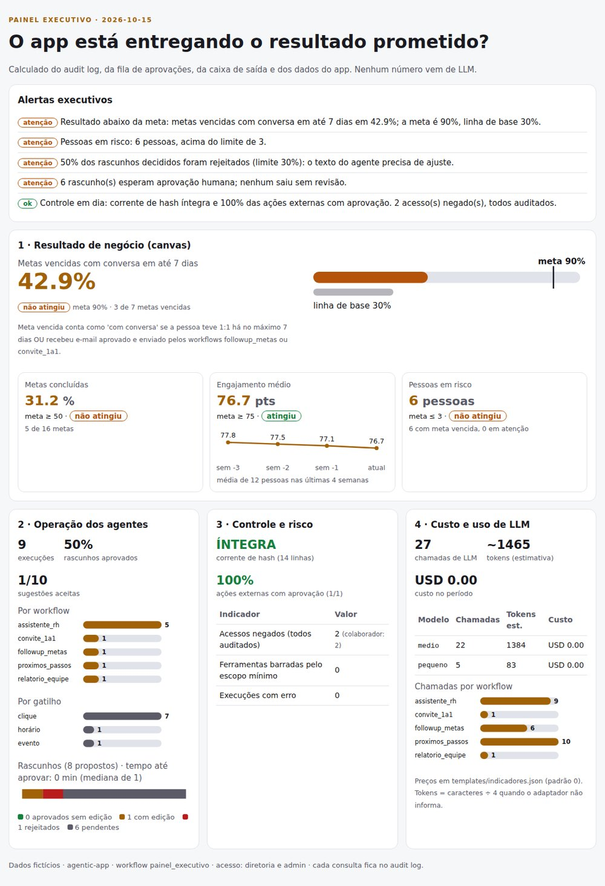
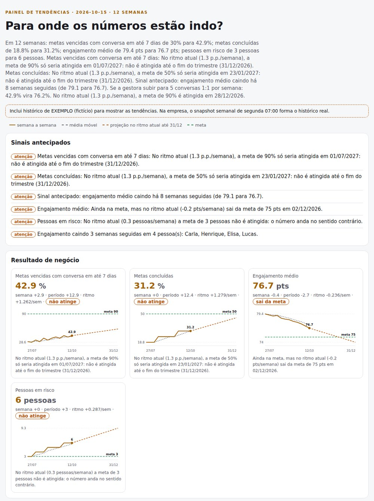

# agentic-app

**🇧🇷 [Português](README.md) · 🇺🇸 [English](README.en.md) · 🇪🇸 [Español](README.es.md)**

[](https://inematds.github.io/agentic-app/guia/)

## O que é

O agentic-app é um framework em Python para empresas construírem apps de IA a partir de um resultado de negócio, e não a partir do agente. Ele serve para quem precisa colocar IA dentro de um processo real (RH, gestão de pessoas, atendimento) com controle: o LLM roda dentro de um workflow fixo, toda ação externa espera aprovação humana, regras com número viram código testado e cada execução fica registrada. Vem com um app completo de exemplo (coaching de gestor) e roda só com o Python 3 instalado, sem chave e sem internet.

## 📖 Guia de uso

Guia completo (landing + passo a passo): **https://inematds.github.io/agentic-app/guia/**

## Em 2 minutos

```bash
git clone https://github.com/inematds/agentic-app
cd agentic-app
bash tests/run.sh                 # 75 checks, sem rede -> última linha OK
python3 -m agentic_app.demo       # roda os 5 workflows, gera saida/relatorio.html e saida/executivo.html
python3 -m agentic_app.serve      # painel em http://127.0.0.1:8765 (executivo: /executivo?usuario=dora)
```

Nada para instalar além do Python 3.10+. O LLM padrão é o `FakeLLM` (determinístico). Para usar um modelo local:
`AGENTIC_LLM=ollama python3 -m agentic_app.demo` (Ollama em `localhost:11434`).

## Os 9 pilares (e onde cada um está no código)

| # | Pilar | Onde |
|---|---|---|
| 1 | **Resultado de negócio primeiro** — quem usa, que decisão, qual métrica | `templates/canvas-resultado.md`, campo `resultado_de_negocio` de cada workflow |
| 2 | **LLM dentro de workflow determinístico** — 5 tipos de nó: contexto → código → condição → LLM → formatação; modelo escolhido pela tarefa | `agentic_app/workflow.py`, `agentic_app/config.py` |
| 3 | **Componente de UI chama workflow** — resultado volta para a própria tela (rascunho editável) | `agentic_app/painel.html`, `agentic_app/serve.py` |
| 4 | **Humano no comando** — workflow só PROPÕE; enviar exige revisar, editar e aprovar | `agentic_app/acoes.py` |
| 5 | **Agentes de fundo** — observam os dados e sugerem próximos passos com botão de executar | workflow `proximos_passos` |
| 6 | **Política vira código testado, não RAG** — o documento vira funções com entrada estrita; RAG só para pergunta aberta | `agentic_app/policies/ferias.py`, `tests/test_politica_ferias.py` |
| 7 | **Segurança por workflow** — quem executa (papéis), com qual identidade age, audit log encadeado | `agentic_app/seguranca.py` |
| 8 | **Gatilhos além do clique** — manual, agendado, evento | `agentic_app/gatilhos.py` |
| 9 | **Saída visual** — relatório HTML + PDF em vez de parede de texto | `agentic_app/relatorio.py` |

## O app de referência: Coaching de gestor

Ana é gestora de 12 pessoas (dados fictícios). O painel tem cinco componentes, cada um ligado a um workflow:

| Componente | Workflow | O que faz |
|---|---|---|
| Painel de engajamento | (leitura direta) | metas, engajamento e dias desde o último 1:1, sem LLM |
| Follow-up de metas | `followup_metas` | rascunho de e-mail para quem não bateu a meta; Ana edita e aprova |
| Próximos passos | `proximos_passos` | agente de fundo (segunda 08:00) sugere com quem falar; executar gera rascunho para revisão |
| Assistente de RH | `assistente_rh` | classifica a pergunta, carrega só a política certa, dá ao agente só as ferramentas dela |
| Relatório | `relatorio_equipe` | HTML + PDF da equipe |

Um quinto workflow, `convite_1a1`, é chamado pelas sugestões do agente de fundo.

## Painel executivo (1.1.0)

A visão de quem patrocina o app: **está entregando o resultado do canvas, com segurança e a que custo?**
Workflow `painel_executivo` (só papéis `diretoria` e `admin`; colaborador e gestor são negados e auditados),
rota `/executivo`, `saida/executivo.html` + `.pdf`. Tudo calculado do `audit.jsonl`, da fila, da caixa de saída e
dos dados do app, por `agentic_app/executivo.py`, com saída validada por esquema:

| Bloco | O que mostra (números da demo) |
|---|---|
| Resultado de negócio | métrica do canvas: 42,9% das metas vencidas com conversa em até 7 dias (meta 90%, base 30%); metas concluídas 31,2%; engajamento médio 76,7; 6 pessoas em risco |
| Operação dos agentes | 9 execuções (clique 7, horário 1, evento 1); rascunhos 1 aprovado com edição, 1 rejeitado, 6 pendentes; 1 de 10 sugestões aceitas |
| Controle e risco | acessos negados por papel, ferramentas barradas pelo escopo mínimo, corrente de hash íntegra ou quebrada, 100% das ações externas com aprovação |
| Custo de LLM | 27 chamadas por modelo e por workflow, tokens estimados, custo pela tabela de `templates/indicadores.json` (padrão 0) |
| Alertas | 3 a 5 frases montadas por regra, não por LLM |



## Tendências (1.2.0)

O executivo responde "está entregando agora?". O painel de tendências responde **"para onde está indo?"**.
Workflow `painel_tendencias` (papéis `estrategia`, `diretoria`, `admin`), rota `/tendencias`,
`saida/tendencias.html` + `.pdf`, calculado por `agentic_app/tendencias.py`, sem biblioteca externa:

- **Histórico**: 12 semanas de exemplo (fictício, rotulado) + o snapshot semanal real gravado pelo workflow
  `snapshot_indicadores` toda segunda 07:00. Numa empresa, o histórico se forma sozinho.
- **Análise**: variação na semana e no período, média móvel de 4 semanas, ritmo por regressão linear e projeção até
  a meta. Na demo: a cobertura de metas vencidas sobe 1,3 p.p. por semana e só chegaria a 90% em 01/07/2027, ou seja,
  não é atingida até 31/12/2026; o engajamento ainda está na meta, mas sai dela em 02/12/2026.
- **Sinais antecipados**: engajamento médio caindo há 8 semanas; 4 pessoas com 3 quedas seguidas.
- **E se**: com 5 conversas 1:1 por semana a cobertura vira 76,2% e a meta de 90% chega em 28/12/2026 (regra
  explícita no código, não previsão).
- Com menos de 4 semanas o painel diz "histórico insuficiente" em vez de projetar. O LLM só costura a narrativa.



## Mapa do repositório

| Caminho | O que é |
|---|---|
| `agentic_app/workflow.py` | motor: carrega a spec JSON, executa os nós, valida, audita |
| `agentic_app/llm.py` | `FakeLLM` (padrão) e `OllamaLLM` (opcional, local) |
| `agentic_app/esquema.py` | validador de JSON da saída (subconjunto de JSON Schema) |
| `agentic_app/acoes.py` | fila de aprovação e caixa de saída simulada |
| `agentic_app/seguranca.py` | usuários, papéis, identidades com escopo, audit log com hash |
| `agentic_app/gatilhos.py` | manual, agendado, evento |
| `agentic_app/policies/` | políticas codificadas (manual fictício de RH) |
| `agentic_app/apps/coaching/` | app de referência: dados, workflows JSON, funções |
| `agentic_app/executivo.py` | painel executivo: indicadores de resultado, operação, controle e custo + alertas por regra |
| `agentic_app/tendencias.py` | painel de tendências: histórico semanal, ritmo, projeção, sinais e cenários |
| `templates/` | canvas, modelo de workflow, modelo de política + teste, matriz de permissões, indicadores do executivo, tendências |
| `docs/PASSO-A-PASSO.md` | do zero à implantação numa empresa (12 passos + checklist) |
| `docs/ARQUITETURA.md` | como as peças se encaixam |
| `tests/` | `run.sh` (75 checks sem rede) e `prova_mutacao.sh` |

## Onde ele se encaixa

O agentic-app é a camada **app + workflows de negócio**. Ele não substitui os outros dois kits INEMA, se apoia neles:

- **[agentic-starter](https://github.com/inematds/agentic-starter)** ([guia](https://inematds.github.io/agentic-starter/guia/)) — o agente da empresa em arquivos: identidade, skills, regras e medição. Responde "**quem** é o agente e como ele trabalha aqui".
- **[inema-agent-runtime](https://github.com/inematds/inema-agent-runtime)** ([guia](https://inematds.github.io/inema-agent-runtime/guia/)) — como os agentes descobrem, conectam e usam as ferramentas que você já tem. Responde "**por onde** o agente chega nas ferramentas".
- **agentic-app** (este) — a aplicação que a pessoa de negócio usa: tela, workflow fixo, política em código, aprovação e auditoria. Responde "**que resultado** a empresa ganha e como isso roda todo dia".

## Licença

MIT. Dados, pessoas e manual de RH do exemplo são fictícios.

INEMA.CLUB · https://inema.club
